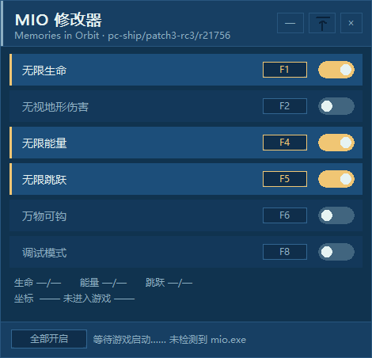

# MIO 修改器（MIO Trainer）

MIO: Memories in Orbit 的图形化修改器，原生 Win32 + GDI 手绘界面，无第三方运行时依赖，**单文件 exe，双击即用**。

> 目标游戏版本：`pc-ship/patch3-rc3/r21756`（Steam 发行版）  
> 仅支持 Windows x64。

## 功能

| 功能     | 热键   | 说明                               |
| ------ | ---- | -------------------------------- |
| 无限生命   | `F1` | 受伤仅回到默认点位，不减少血量                  |
| 无视地形伤害 | `F2` | 无视地形伤害（Platforming invulnerable） |
| 无限能量   | `F4` | 发夹/滑翔/神行步能量冻结在上限                 |
| 无限跳跃   | `F5` | 空中无限次跳跃                          |
| 万物可钩   | `F6` | 任意表面可使用发夹                        |
| 调试模式   | `F8` | 开启开发者叠加层                         |

- 鼠标点击开关、或按对应热键切换，均可。
- 底部状态栏实时显示 生命 / 能量 / 跳跃 / 坐标。
- 自动连接运行中的 `mio.exe`，游戏关闭后自动分离。

## 界面展示



## 下载

本仓库**只托管源码**。可直接运行的 `MIO_Trainer.exe` 请在项目的 **Releases** 页面下载（请选择与目标游戏版本 `r21756` 匹配的发布）。

下载后双击即可运行；若无法连接游戏，右键以管理员身份运行。

## 使用方法

1. 启动游戏 `MIO.exe`。
2. 运行 `MIO_Trainer.exe`（若无法连接，右键以管理员身份运行）。
3. 点击开关或按热键启用所需功能。
4. 标题栏右侧三个按钮：`—` 最小化、置顶图标（深蓝=已置顶/灰色=浮动）、`×` 关闭。
5. 窗口可拖拽四边/四角改变大小，内容自适应缩放。

## 编译

需要 MinGW-w64（gcc + windres）。仓库内已提供 `build.bat`，双击即可一键编译；或手动执行：

```bash
windres MIO_Trainer.rc -o MIO_Trainer.res.o
gcc -O2 -s -mwindows -o MIO_Trainer.exe MIO_Trainer.c MIO_Trainer.res.o \
    -lpsapi -lgdi32 -luser32
```

产物为单文件 exe，导入表只包含系统 DLL（`KERNEL32 / USER32 / GDI32 / PSAPI / msvcrt`），可直接分发。编译出的 `MIO_Trainer.exe` 请作为 GitHub Release 附件发布，不要提交进仓库（见 `.gitignore`）。

## 项目结构

```
MIO_Trainer.c        源码（单文件，含全部逻辑与界面）
MIO_Trainer.rc       资源文件（嵌入 exe 图标）
MIO_Trainer.ico      exe 图标（取自游戏原版图标）
build.bat            一键编译脚本（MinGW-w64）
screenshot.png       界面截图
README.md            本文件
LICENSE              MIT 许可证
.gitignore           忽略编译产物与开发杂项
```

> 逆向辅助脚本（`*.py`、汇编 dump、快照等）属于开发期工具，未纳入发布仓库，以免干扰使用者。

## 日志（排错用）

修改器运行时会在 **exe 同目录**生成 `MIO_Trainer.log`，记录关键事件：

- 启动 / 关闭
- 连接游戏（PID、模块基址）或连接失败原因（错误码）
- 游戏退出自动分离
- 每次功能切换（功能名 + 开/关）
- 内存写入失败（目标 RVA + 功能名）

日志启动时若超过 256KB 会自动清空，不会无限增长。**遇到 bug 时请把这份日志一并附上**，便于定位问题。

## 扩展

源码顶部有完整的目录索引与扩展指南。最常见的情况：

- **新增一个标志位功能**：在 `g_feat[]` 表里加一行即可
  ```c
  { L"显示名", L"热键", VK_xx, KIND_FLAG, RVA_XXX + 偏移, 目标值, 0 },
  ```
- **新增一种行为类型**：在 `enum` 加 `KIND_XXX`，在 `apply_all()` 的 `switch` 加对应 `case`，如需显示则在 `read_live()` 里读取。

地址表（RVA 与字段偏移）位于源码第 1 节，逆向新版本游戏时按需更新即可。

## 免责声明

- 本修改器仅适用于 **单机游戏** MIO: Memories in Orbit，**不涉及任何在线/多人/竞技功能**。
- 本项目与游戏开发商、发行商无任何关联，未获其授权或背书。
- 本修改器**不读写任何游戏存档文件**，只做内存读写，不向游戏进程注入代码。
- 使用本修改器产生的任何后果（包括但不限于游戏异常、存档损坏、账号问题）由使用者自行承担。
- 请勿将本修改器用于商业用途或任何违反游戏服务条款的场景。
- 本项目主要借助 **AI Agent（人工智能助手）** 辅助开发完成，可能因此存在开发者尚未察觉的隐患或缺陷；使用者应自行审查代码，并在充分理解风险后使用。
- 本项目按「现状」提供，不提供任何明示或暗示的担保。

## 许可证

MIT License，详见 [LICENSE](LICENSE)。
